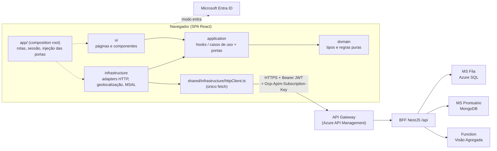

# Open Prontuário — Frontend (microfrontend SPA)

SPA em React do **Open Prontuário**: fila de UPAs e UBS de Curitiba organizada por **risco clínico** (protocolo de Manchester), com o prontuário compartilhado **só com a unidade que o paciente autorizar e pelo prazo que ele escolher** (modelo de consentimento do Open Finance).

Uma única aplicação atende três áreas, escolhidas pelo perfil do usuário:

| Área | Perfis | Telas | Requisitos |
|---|---|---|---|
| **Paciente** (mobile-first) | PACIENTE | Unidades próximas, aviso de chegada, autorizações (consentimentos), meu prontuário + quem acessou | RF01–RF06, RF16 |
| **Atendimento** (desktop-first, denso) | ATENDENTE, PROFISSIONAL | Seleção da unidade, fila com polling de 5 s e ações de um clique, prontuário auditado, registro de atendimento | RF07–RF15 |
| **Gestão** | GESTOR | Indicadores do `/aggregated-data` (com proveniência das três fontes), auditoria, CRUD de unidades, lotações | RF16, RF18 |

O frontend fala **somente com o BFF** (em nuvem, através do API Gateway). Nunca chama os microserviços nem a Function diretamente.

## Arquitetura



**Clean Architecture por feature (vertical slice).** Cada feature tem as quatro camadas; o que é comum mora em `shared/` com as mesmas camadas:

- `domain` — tipos e regras puras: ordenação da fila (`OrdenacaoFilaPolicy`), ações válidas pela máquina de estados do `RegistroFila`, situação presente × a caminho, validade do consentimento (`estaValido(agora)`), distância/ordenação de unidades, validações com as mesmas faixas do contrato. Sem React, sem `fetch`, sem APIs do navegador.
- `application` — hooks/casos de uso (`useFila`, `useProntuario`, `useConsentimentos`…) que dependem só de **portas** (interfaces em `ports.ts`).
- `infrastructure` — adapters que implementam as portas chamando o BFF pelo `httpClient` (ou a Geolocation API e o MSAL).
- `ui` — páginas React; recebem a porta por props.
- `app/` — composition root: cria o `httpClient`, instancia os adapters (`container.ts`), guarda a sessão e protege as rotas por perfil.

Regras verificadas automaticamente (ver [Testes de arquitetura](#testes-de-arquitetura)): `ui → application → domain`; `infrastructure → application → domain`; `ui` e `infrastructure` não se importam; `domain` não importa React nem bibliotecas; uma feature não importa outra feature; `shared` não importa features; sem ciclos; `fetch` só em `shared/infrastructure/httpClient.ts`.

### Estrutura

```
src/
  app/                      composition root: App (rotas), Areas (shells), Protegida (perfil),
                            container (injeção das portas), sessão
  shared/
    domain/                 tipos do contrato, prioridade (Manchester), erros por codigo, datas, perfis
    application/            useConsulta (com polling), useAcao, contexto de sessão
    infrastructure/         httpClient (único fetch), config (VITE_*), sessaoStorage
    ui/                     tokens CSS, Pulseira, Medidor, estados (carregando/vazio/erro), shells
  features/
    auth/login/                         {domain,application,infrastructure,ui}
    paciente/unidades-proximas/         {domain,application,infrastructure,ui}
    paciente/aviso-chegada/             {…}
    paciente/consentimentos/            {…}
    paciente/meu-prontuario/            {…}
    atendente/selecao-unidade/          {…}
    atendente/fila/                     {…}
    atendente/prontuario/               {…}
    gestor/indicadores/                 {…}
    gestor/auditoria/                   {…}
    gestor/unidades/                    {…}
    gestor/lotacoes/                    {…}
test/                       setup, utilitários de render, fakes e teste de arquitetura
scripts/dev-mock/           servidor FALSO opcional, só para desenvolvimento visual (npm run dev:mock)
deploy/nginx.conf           nginx da imagem Docker (fallback de SPA, /healthz, cabeçalhos)
public/staticwebapp.config.json   Azure Static Web Apps (navigationFallback e cabeçalhos)
```

## Direção de design

**“Parede de hospital e ficha de papel.”** O fundo verde-acinzentado lembra a pintura das unidades de saúde; as superfícies são fichas claras; as ações usam o azul da tinta de carimbo. A cor saturada fica reservada às **cinco cores da pulseira de Manchester**, a assinatura visual do sistema: cada prioridade é uma pulseira com **cor + forma + rótulo** (cruz, triângulo, losango, quadrado, círculo), então a cor nunca é o único sinal. Na fila, cada linha “veste” a pulseira na borda esquerda, com o furo do fecho.

- Tipografia: **Big Shoulders Display** (fonte de sinalização urbana, condensada) para títulos e números do placar; **Atkinson Hyperlegible Next** no texto, criada para leitura com baixa visão; **Atkinson Hyperlegible Mono** para horários, códigos e durações.
- **Presente × a caminho**: presente é uma ficha sólida com ícone de chegada; a caminho é tracejada e hachurada, com a previsão (“chega em ~12 min”). Em atendimento fica num grupo à parte, em azul.
- Atendimento denso para o balcão (tabela, placar escuro como painel de senhas, ações de um clique); paciente em coluna única com navegação inferior ao alcance do polegar.
- Estados de carregando, vazio e erro em todas as telas; erros traduzidos pelo `codigo` do problem+json (ex.: `CONSENTIMENTO_AUSENTE` → explicação para o profissional, sem nenhum dado clínico).
- Acessibilidade: contraste AA, foco visível, link “pular para o conteúdo”, rótulos em todos os campos, `aria-live` nas confirmações, foco no primeiro campo inválido, respeito a `prefers-reduced-motion`. A UI passou pela revisão das Web Interface Guidelines.

## Tecnologias

React 19 · TypeScript (strict) · Vite 7 · React Router 7 · `@azure/msal-browser` (modo `entra`, carregado sob demanda) · CSS próprio com tokens em variáveis (sem biblioteca de componentes) · Vitest 4 + Testing Library + jsdom · dependency-cruiser · ESLint 9 (typescript-eslint, react-hooks) · Docker (nginx-unprivileged) · Azure Static Web Apps · GitHub Actions.

## Como rodar

Pré-requisito: Node 20+ (testado com Node 24 / npm 11).

```bash
npm ci
cp .env.example .env.local     # ajuste as variáveis
npm run dev                    # http://localhost:5173
```

**Apontando para o BFF local** (`docker compose` do repositório `open-prontuario-platform` ou BFF rodando na porta 3000):

```bash
VITE_API_BASE_URL=http://localhost:3000/api VITE_AUTH_MODE=dev npm run dev
```

O BFF precisa liberar a origem em `CORS_ORIGINS` (ex.: `http://localhost:5173,http://localhost:8080`).

**Apontando para o API Gateway em nuvem** (Azure API Management na frente do BFF):

```bash
VITE_API_BASE_URL=https://<seu-apim>.azure-api.net/api \
VITE_APIM_SUBSCRIPTION_KEY=<chave-do-produto-no-APIM> \
VITE_AUTH_MODE=dev \
npm run dev
```

Com `VITE_APIM_SUBSCRIPTION_KEY` definida, **todas** as chamadas levam o header `Ocp-Apim-Subscription-Key`. A chave vai embutida no bundle (é chave de produto do APIM, para identificação e rate-limit, não segredo); a autorização de verdade é o JWT validado pelo BFF.

**Só para ver as telas sem backend** (opcional): `npm run dev:mock` sobe um servidor **falso** em memória na porta 3999 e o Vite apontando para ele. Ele existe apenas para desenvolvimento visual, não implementa as regras reais e não é usado pelo build, pelos testes nem pela imagem Docker.

### Personas do modo dev

Com `VITE_AUTH_MODE=dev`, a tela de entrada lista as personas do BFF (`GET /api/auth/personas`) e o login emite um JWT de demonstração (`POST /api/auth/dev-token`):

| `usuarioId` | Nome | Perfil | Lotações | Vai para |
|---|---|---|---|---|
| `pac-101` | João Pereira | PACIENTE | — | `/paciente/unidades` |
| `pac-102` | Maria Souza | PACIENTE | — | `/paciente/unidades` |
| `usr-atendente-07` | Carla Mendes | ATENDENTE | `upa-01`, `upa-02` | `/atendimento` |
| `usr-prof-03` | Dr. Paulo Lima | PROFISSIONAL | `upa-01` | `/atendimento` |
| `usr-gestor-01` | Lúcia Andrade | GESTOR | `upa-01`, `upa-02`, `ubs-03` | `/gestao/indicadores` |

### Modo Entra ID (MSAL)

1. No portal do Entra ID, registre um aplicativo **SPA** com redirect URI igual à origem do frontend (ex.: `http://localhost:5173` e a URL do Static Web Apps).
2. No registro da API do BFF, exponha um escopo (ex.: `api://open-prontuario-bff/acesso`) e defina os *app roles* `PACIENTE`, `ATENDENTE`, `PROFISSIONAL`, `GESTOR`; atribua-os aos usuários.
3. Dê ao app SPA permissão para o escopo da API e conceda consentimento de administrador.
4. Configure `VITE_AUTH_MODE=entra`, `VITE_ENTRA_CLIENT_ID`, `VITE_ENTRA_TENANT_ID` e `VITE_ENTRA_API_SCOPE` e gere o build. O login abre um popup da Microsoft; o perfil vem de `GET /api/auth/me` no BFF.

## Variáveis (somente de build)

| Variável | Exemplo | Uso |
|---|---|---|
| `VITE_API_BASE_URL` | `http://localhost:3000/api` | URL do BFF (local) ou do API Gateway (nuvem), com `/api`. Sem ela, usa `/api` no mesmo domínio. |
| `VITE_APIM_SUBSCRIPTION_KEY` | *(vazia no local)* | Se definida, enviada como `Ocp-Apim-Subscription-Key` em todas as chamadas. |
| `VITE_AUTH_MODE` | `dev` ou `entra` | Seletor de persona ou Microsoft Entra ID. |
| `VITE_ENTRA_CLIENT_ID` / `VITE_ENTRA_TENANT_ID` / `VITE_ENTRA_API_SCOPE` | — | Somente no modo `entra`. |

Nada de URL fixa no código: tudo vem dessas variáveis (veja `.env.example`).

## Como testar

```bash
npm test          # testes de domínio, casos de uso, telas, httpClient e arquitetura + cobertura
npm run lint      # ESLint (inclui a regra que proíbe fetch fora do httpClient)
npm run build     # checagem de tipos (tsc --noEmit) + build de produção
npm run test:arch # só o dependency-cruiser, com saída legível
```

- **Domínio** de cada feature: ordenação/agrupamento da fila, situação presente × a caminho, ações válidas por status, rótulos de prioridade, validade/renovação/revogação de consentimento, distância e ordenação de unidades, validações dos formulários.
- **Casos de uso / hooks** com fakes das portas: polling de 5 s da fila, ações que recarregam a fila, 409 `TRANSICAO_INVALIDA`, 503 no polling mantendo a última fila, 403 `CONSENTIMENTO_AUSENTE` e 503 de auditoria no prontuário, 409 de consentimento duplicado e de registro ativo duplicado.
- **Telas** com Testing Library (consultas por role/label): estados de carregando/vazio/erro e ações de um clique chamando o caso de uso.
- **httpClient**: `Authorization: Bearer`, `Ocp-Apim-Subscription-Key`, `X-Correlation-Id`, conversão de problem+json em erro tipado com `codigo`, 204, 401 e falha de rede.
- **Cobertura** mínima de 80% (linhas, funções, ramos, instruções) em `domain` e `application`, configurada como *threshold* no Vitest: abaixo disso `npm test` falha.

### Testes de arquitetura

`test/arquitetura.test.ts` roda o **dependency-cruiser** com as regras de `.dependency-cruiser.cjs` e faz varreduras extras (`fetch` só no `httpClient`, `domain` sem APIs do navegador nem hooks, cada feature com as quatro camadas).

**Comprovação de que falha:** com violações propositais (não commitadas): o domínio da fila importando `react`, `application/ports` e o domínio de outra feature, e uma página importando o adapter `infrastructure` da própria feature. O dependency-cruiser acusou `x 4 dependency violations` (`domain-sem-bibliotecas`, `domain-puro`, `feature-isolada`, `ui-nao-conhece-infrastructure`) e o `npm test` ficou vermelho em 3 dos 4 testes de arquitetura (o `fetch` no domínio também foi pego pela varredura). Depois de reverter, tudo voltou a passar.

## Docker

```bash
docker build -t open-prontuario-frontend:local \
  --build-arg VITE_API_BASE_URL=http://localhost:3000/api \
  --build-arg VITE_AUTH_MODE=dev .
docker run --rm -p 8080:8080 open-prontuario-frontend:local   # http://localhost:8080
```

Multi-stage: `node:24-alpine` faz o build do Vite com os `ARG VITE_*`; o runtime é `nginxinc/nginx-unprivileged` (usuário 101, porta 8080) com fallback de SPA, `/healthz` usado no `HEALTHCHECK`, cache imutável em `/assets` e cabeçalhos de segurança (CSP, `nosniff`, `frame-ancestors 'none'`). Publicação no Docker Hub fica a cargo do script do repositório `open-prontuario-platform` (`<usuario>/pjbl/frontend:<tag>`).

## Deploy (Azure Static Web Apps)

`public/staticwebapp.config.json` vai para o `dist/` e define o `navigationFallback` para `index.html` (rotas do React Router) e os mesmos cabeçalhos de segurança. No pipeline de deploy, gere o build com `VITE_API_BASE_URL` apontando para o API Gateway e `VITE_APIM_SUBSCRIPTION_KEY`, e publique a pasta `dist` (`app_location: dist`, `skip_app_build: true`).

## CI

`.github/workflows/ci.yml`: `npm ci` → lint → testes com cobertura (inclui arquitetura) → dependency-cruiser → build → `docker build`.

## Limitações conhecidas

- Sem renovação silenciosa do token no modo `entra`: ao expirar (~1 h) o usuário entra de novo.
- Unidades próximas em lista ordenada por distância (sem mapa), para não adicionar dependência; a distância vem do BFF (Haversine no MS Fila).
- A fila não é virtualizada (pensada para dezenas de pacientes por unidade).

## Alunos

- Ana Paula Alves
- Artur Bertoni
- Bernardo Plottegher
- Luiz Fernando Grenteski
